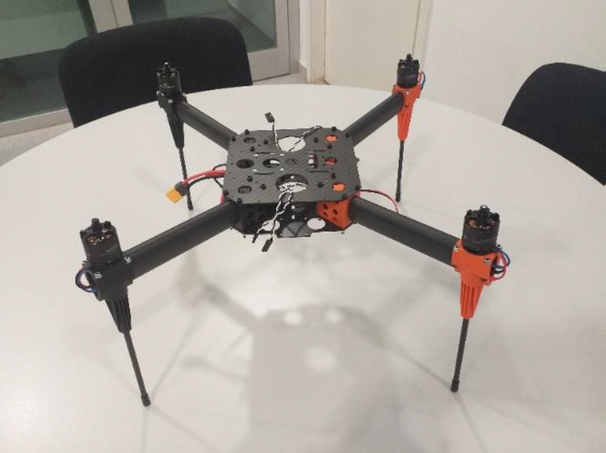

# 📡Transversal Drone Project (GROUP 1)📡
Transversal project from group 1. Project made at EETAC as part of the master of drones.
This groups is composed by Miguel Alvarez Fernandez, Aidan Cuadra Madrid, and  Marawan El Mozy.

## 🛩️Very Basics of the Drone and its Components🛩️

When we started the transversal project, the first thing we had to understand was simply: what is a drone, and what are the main parts that make it fly? 

A drone (or UAS) is basically a flying robot made of several subsystems that work together: the frame, the motors and propellers, the electronics, the sensors, the battery, and the software that controls everything.  

The Hexsoon EDU450 is a quadcopter designed for education and research. Understanding this particular drone helped us connect the basic theory to a real system. 

The EDU450 is built around a 450mm carbon fiber frame, which makes it lightweight but strong enough for training flights and small payloads. The frame follows the classic 'X' quadcopter layout, meaning it has four arms with one motor on each arm this layout is very common because it provides good stability and simple control 

### ⚙️Airframe (Structure)⚙️ 

The frame is the physical body of the drone. It's usually made of carbon fiber because it's strong and lightweight, its job is to hold everything together: motors, flight controller, battery, GPS, wiring, etc. 

* The frame of the EDU450 is made of Carbon fiber plates and arms. 
* During the first sessions, we noticed how rigid the material is.  
* This is important because it reduces vibrations that could affect the sensors.
  
## The frame includes:  
* Central Plates for mounting the flight controller 
* Four arms for the motors 
* Landing gear 
* Space for the battery Underneath 

### ⚡Propulsion system⚡

This is the part that makes the drone fly 

### ⚙️Motors⚙️

The EDU450 uses brushless motors that are typical for medium-size quadcopters. 

Each motor has a specific rotation direction (two clockwise, two counterclockwise), which is essential for stable flight. 

### 🪶Propellers🪶

The propellers are also matched to the motors, we learned that installing a propeller in the wrong direction would make the drone unable to lift off, so this detail is more important than it seems 

### 📟ESCs (Electronic speed controllers)📟  

ESCs are small electronic boards that control how fast each motor spins. 

They receive commands from the flight controller and adjust the motor speed instantly to keep the drone stable.  

### ⚡Power System⚡

The drone is powered by a LiPo battery. 

These batteries are lightweight and can deliver high current (usually 4S {14.8V}), which provides enough power for the motors and electronics. 

The battery is mounted under the frame using straps, and it connects to the power distirbution board that sends power to the ESCs and the flight controller. 

### 🧠Autopilot🧠 

This is basically the brain of the drone. 

The EDU450 is designed to work with open-source autopilots like Pixhawk, and it runs PX4 or ArduPilot Firmware 

It includes: 

* IMU (accelerometer + gyroscope)  
* Magnetometer 
* Barometer 
* Microprocessor 

This controller is mounted on vibration-damping foam or rubber to reduce noise from the motors.  

### We also connected: 

* GPS module 
* Telemetry radio 
* RC receiver 
The flight controller reads all these sensors and constantly adjusts the motors to keep the drone stable.  
It also receives commands from the pilot and executes them. 

### 📍Navigation & Sensors📍 

The GPS module is mounted on a small mast to reduce interference from electronics. 
It provides positions, altitude, and heading. 
Telemetry is done through a radio module that sends real-time data to QGroundControl. 

### 🐍Raspberry Pi Integration (Optional)🐍 

This project also introduced the possibility of using a Raspberry Pi as a Companion computer. 

This allows more advanced tasks like:
* Autonomous missions 
* Computer vision 
* Data logging 
* Custom scripts 

During the project we had to deal with some missing or broken components which had unfortunately made the process of assembly longer than expected.

## 🎮Radio Control🎮

The central focus of this step in the project was to configure the radio controls allowing the Transversal Drone to be able to fly. Below is a list of all the required elements that were used in this step.

The radio used to pilot the drone utilizes up to 24 channels that are multiplexed using flexible division multiplexing technique. The radio’s actuators can vary the signals emitted by a certain channel. The drone’s radio receiver picks up on the signals from different channels and converts them into PWM signals which then becomes the output of the receiver onto the associated channel. These PWM signals are necessary for the drone to be able to operate the drone’s brushless DC motors where the corresponding width’s of these signals will determine the rotational velocity of the motors at distinct time intervals.

In order to configure the radio to achieve this end, the OpenTX software was used, allowing the group to create a model associating actuator inputs from the radio to a desired radio channel. Once the model was created, the motors and servo were connected to power to test that the setup was successful and that all of the inputs from the radio corresponded to the correct outputs.

## 📂Unboxing the Hexsoon EDU450📂

# Introduction
This was our first hands-on session with the drone we will assemble and fly during the transversal project. Unboxing the Hexsoon EDU450 made everything feel more real. Seeing the actual components helped us understand how the drone is built and how each part fits into the final system.

# 📦What was inside the Box📦 
When we open the box, everything needed to fly a drone was there, from the fiber plates and the motors to the arms and screws, we took our time to go through each item carefully.

inside was:
* Main top carbon fiber plate
* Main bottom carbon fiber plate
* 4 aerofoil arms (teardrop shape, slightly tilted upward)
* Motor holder top pieces
* Motor holder bottom pieces
* Landing gear
* All screws, nuts, and joints needed for assembly
  
  ## Propulsion System
* 4× brushless motors (HS2216 920KV)
* 4× propellers (T1045II)
* 4× ESCs (20A)
  
  ## Power System
* PDB‑40A (Power Distribution Board)
* ESC pads
* 5V output
* 12V output

## Accessories
* Cable ties
* Mounting hardware
* LED lamp (depending on kit version)
  
## Not included (but required later)
* Autopilot (Cube or similar)
* LiPo battery
* RC transmitter
Everything was packed in a way that made it easy to identify each part without mixing anything.

# 🔍First Impressions🔍
The first thing we noticed was how light the carbon fiber plates were. The aerofoil arms looked more “aerodynamic” than we expected, and the ESCs were designed to fit inside the arms, which surprised us at first.

The motors felt solid, and the propellers were clearly marked for rotation direction. The PDB looked more complex than we imagined, with many pads and outputs, so we knew we had to be careful with it later.

# 🧰Component Inspection🧰
Before touching anything, we inspected each part slowly to understand what we were dealing with.

## ⚙️Motors⚙️
All four motors looked identical, but we noticed later the rotation direction that would matter later for the assembly.

## 🪶Propellers🪶
The propellers came in CW and CCW pairs. We made sure not to mix them.

## 📟ESCs📟
The ESCs were small and lightweight. We realized they would be hidden inside the arms, which made cable routing important.

## 🧱Frame Plates🧱
The plates had precise holes and clean edges. We checked them for any cracks or defects.

## 🔗PDB🔗
The PDB‑40A had multiple outputs and solder pads. It looked intimidating at first, but everything was in good condition.

# 🔌Quick Pre‑Assembly Check🔌
Before starting assembly, we did a simple check:
* Verified ESC connectors
* Checked motor connectors
* Looked for missing screws
* Checked cable quality
* Confirmed nothing was damaged
* Everything looked fine and ready for assembly.

# 🎓Reflection🎓
Unboxing the EDU450 was more interesting than we expected. Seeing the real components helped us understand the drone much better than just reading theory. The frame, motors, ESCs, and PDB all looked more serious and professional than we imagined, and it made us appreciate how much engineering goes into even a simple quadcopter.

This step also taught us how important organization is. If we mixed up screws or didn’t understand how the ESCs fit inside the arms, assembly would be much harder. After unboxing, we felt more confident and ready for the next steps: frame assembly, wiring, and sensor calibration.

## 🛠️Frame Assembly (Part 1)🛠️

The main objective of this step of the transversal drone project was to assemble the frame and main flying elements of the drone our group will utilize going forward. 

The transversal drone is a simple quad-copter layout; therefore, the assembly of the frame included the central body containing the power distribution board and the four arms connecting to the set of four brushless DC motors. The result of this step yields a drone frame as shown below:

The assembly of the drone frame wasn’t particularly complicated, however, there were some key things to keep in mind: one, that the drone’s motors were correctly mounted making sure that they are spinning in the correct direction during flight, two, that the arms and frame were correctly oriented, and three, that there was sufficient space inside the frame for all the wiring to be well organized and functional. Note that the side with the orange arms was defined to be the front face of the drone.

In the end, the first part of the drone frame assembly was completed without issue, and the assembly of the drone frame would continue in the second part focusing more on guidance and power systems.

## 🧠Autopilot Configuration and Calibration🧠

In this activity, we worked with the Pixhawk Orange Cube autopilot to learn how it works and how to prepare it for the drone project.

The autopilot is also capable of generating the motor control signals to maintain the stability of the drone, depending on the flight mode that has been chosen. For example, in Alt Hold flight mode the drone will keep its height constant as long as the drone operator does not modify it from the radio. To do this, the autopilot will use the information it obtains from internal sensors (such as the barometer, accelerometer, gyroscope). 
We are gonna configure the SB switch to control the flight mode. Since the SB only have 3 positions, we configure 3 different mode: 

Alt hold: Stabilizes in altitude using the internal barometer

Loiter: Stabilizes in altitude, pitch and roll using the GPS (needs good GPS coverage)

RTL (return to Launch): The drone will return directly to the launch position. First will ascend to a defined altitude.

The autopilot can also execute a flight plan autonomously. In this project, we will configure the laptop as a ground station with the flight plan using Mission Planner.

First, we connected the radio receiver, GPS module and buzzer to the autopilot. 

https://www.youtube.com/watch?v=2Jm9zshM1Sc

Then, we installed Mission Planner on the laptop, which we used as a ground station to configure the autopilot and communicate with it.

https://ardupilot.org/planner/docs/mission-planner-installation.html

Once everything was connected, we installed the required firmware (https://www.youtube.com/watch?v=MUiUbNqETsk). For this we need to connect the Pixhawk Orange Cube to the computer with Mission Planner and go to the setup to install the firmware "Orange cube Plus". When we had the firmware installed, we configured the necessary parameters. First we start with the Frame type. 

After applying the changes following the tutorial, we rebooted the autopilot to check that everything was working correctly. We verified that the LEDs turned on and that the buzzer produced a sound.

https://www.youtube.com/watch?v=8aF4e0XCMpo
 
Next, we calibrated the accelerometer and compass to ensure that the autopilot could correctly estimate the drone's orientation and heading. 

https://www.youtube.com/watch?v=slux0oX2Qig&feature=youtu.be 

We also calibrated the radio and checked the minimum and maximum values. We made sure that all radio controls worked as intended.

https://www.youtube.com/watch?v=0Ii1I8D2gro&feature=youtu.be 

Finally, we configured the three flight modes using switch SB on the radio: Alt Hold, Loiter and RTL. Alt Hold allows the drone to maintain its altitude using its internal sensors, while Loiter uses GPS to help maintain its position. RTL is used to make the drone return to its home position. We also configured the RTL altitude to 7 metres, so that the drone climbs to the selected altitude before returning to the launch point.
For the configuration we can check when the switch is in one position the corresponding flight mode is in colour green, this helps to make sure that we are configuring it correctly.

https://www.youtube.com/watch?v=PNEuuCZnhX0&feature=youtu.be 

Overall, this activity helped us understand the basic configuration and calibration process of the Pixhawk Orange Cube.

## 🛠️Frame Assembly (Part 2)🛠️

The aim of the second part of the frame assembly of the Transversal Project Drone was to finalize the assembly of the drone frame by placing and incorporating the radio receiver, autopilot system, GPS, optical sensor, telemetry radio, and the power supply while ensuring everything is properly connected and integrated. The result of this was a drone that after some final calibrations and some software configuration would be able to begin its maiden flight. 

The first task was to fix the autopilot atop the frame using adhesive. Once in position (ensuring it is facing the correct direction) and connected to the power cables, the next device to be connected was the radio receiver. It was important for this step to ascertain that the device was specifically connected to the SBUS OUT and RCIN input ports of the autopilot system. 

After that, the next devices to connect were the four DC motors to the input ports of the autopilot system. Keeping in mind the rotation direction and connections mentioned in part one of the frame assembly the motors were successfully connected. Following that, the GPS system was connected to the autopilot atop the frame using the CAN 1 input. Next was the telemetry radio, this was necessary to ensure proper communication between the drone and Mission Planner for both telemetry and flight plans. This device was connected to the Telem 1 port of the autopilot positioned within the central body with the antenna protruding out the side of the drone. 

The last element that was incorporated was the battery. A setup of two Velcro straps was used to hang the large battery on the underside of the central body of the drone in a manner that facilitated the connection of the power supply to the rest of the systems on the drone. With all the basic elements of the drone assembled, it was time to move on to further calibrations of the drone.

## 🧪More Calibrations🧪

In this activity, we continued configuring the Pixhawk Orange Cube to prepare the drone for its first flight test.

First, we configured the telemetry radio to establish communication between the drone and the ground station. The baud rate must be the expected from the device, in this case 57600.  

https://www.youtube.com/watch?v=6xqEbOzUQSo&feature=youtu.be 

They are usually configured correctly before, but it's important to check if there is any problem. It can also be done using a google extension.

Then, we calibrated the ESCs (Electronic Speed Controllers) and configured the servo functions.

https://www.youtube.com/watch?v=wO8QJQpC3IM&feature=youtu.be 

Now we configure the servo, failsafe and the arm/dissarm. We followed the tutorials but in this phase we don't have any use for the servo yet.

https://www.youtube.com/watch?v=D1ne2W3uEEE 

The failsafe configuration was particularly important because it determines how the autopilot reacts when something goes wrong. We configured the system to return to the home position if the drone loses contact with the radio.

After that, we configured the battery monitor to check the battery status during operation. We also tested the motors to verify that they responded correctly to the autopilot commands. 

https://www.youtube.com/watch?v=DGpoN0KlAYY&feature=youtu.be

After this we test the motors independly and all together.

https://github.com/user-attachments/assets/731258ab-1225-4bfe-8bda-f014d93e9ac4

https://www.youtube.com/watch?v=w6N368HIncc

During this test we encountered the problem that some of the rotors didn't response to the test. This was a problem of throttle used during test, just increasing the throttle value to 7% was enough to test correctly the "affected" rotors

Before completing the setup, we loaded the default parameters for our drone frame  and performed the final configuration checks.

https://www.youtube.com/watch?v=9pilQ3uT8mA&feature=youtu.be

https://www.youtube.com/watch?v=Af_ygwTi_s0 

It's important to check the battery level before each flight, making sure that every battery cell has a sufficient charge.
Now that we completed succesfully all test, we are ready to fly.

## 🗺️Simulator, Geofences and Mission Planning🗺️

We explored some of the main tools available in Mission Planner to prepare and test drone flights before operating the real platform.
First, we learned about the SITL (Software In The Loop) simulator, which allows us to simulate the behaviour of the autopilot without using the physical drone. This is useful for testing flight plans and understanding how the drone is expected to behave before carrying out an actual flight.

https://www.youtube.com/watch?v=1BPK29MOLlg&feature=youtu.be 

Next, we explored the geofence function, which allows us to define geographical limits for the drone's operating area. We learned how to create a boundary on the map so that the autopilot can detect when the drone is gonna leave the permitted area. We can configure the drone with different actions when leaving the area, like RTL or land. In our case we put the option to brake or land, so the drone stops before leaving the area but if anyway it leaves the area, it lands.

Finally, we worked with the mission planning tools in Mission Planner. We learned how to create a flight plan by adding waypoints, upload the mission to the autopilot and simulate its execution. We also examined what happens when the drone tries to cross the geofence boundaries, it decrease the speed and avoid getting outside as expected.

https://www.youtube.com/watch?v=g-UfZ4gamq8 

Overall, this activity helped us understand how to plan autonomous flights and use simulation and geofencing tools to improve flight preparation and safety. 

## 🚁Flight in the drone lab🚁

Now everything is ready to start the flight, we go to the drone center and first we do just a fast flight, to make sure that it flies. Before flying one of the compasses wasn't responding, lucky for us, we had 2 and the other one was working correcly.

https://github.com/user-attachments/assets/b809198a-2885-4f7a-8cb7-fa62cb7bc3e0

The flight gonne without any issues, the next step was to upload the geofence to the drone. For this flight we made it with the other coleagues of the master, so we used a very small geofence.

This day we had problems that made us unable to us our computers/ground station and we had to use one provided from another student to make the flight. The main computer that we used didn't response well with the "Plan" tab, making unable to load to draw and load the geofence to the drone and for the other computers we just made small mistakes like missing one value of configuration that made it unable to connect to the radio control. Those are small mistakes that consume time but since we had a very limited time, the best option was that a student lend us his computer.

The last we made was uploading a mission plan so the drone does it automatically. But we didn't do that yet, we just had a demostration from another group.

## 📘Personal reflection Phase 1📘

In this phase we learned the basics on building a drone, the importance on location sensors and how the ground station (computer) comunicates with the drone. We also learned the importante in some configurations and the meaning of some values or modes. 

During the project we had some problems to follow correctly since most components were missing or broken, so when doing test the values and procedures were correct but still didn't worked. Also the last day we had last moment problems and with the rush we couldn't correct them before flying with the geofence.

At the end we manage to follow the tutorials and each step to a successfull flight. 

## 🤖Considerations for phase 2🤖

During phase 2 we gonna install and use a camera. Most of the second part of phase 2 we gonna use what we are learning in Payload, from the basic OpenCV image manipulation to Color-based object detection, in the near future we will know more things that we will learn in Payload that will be applied in the project like image stitching.

We also gonna interact with the autopilot to retrieve some data. This data might be related with the positioning that we learned in Unmaned Aircraft since one this that we learned that is important when doing a photogrametry project is to know where you are when doing the photos. Since the battery and the rotors are already installed and provided, I don't think we gonna apply the first temary of the Unmaned Aircraft subject.

